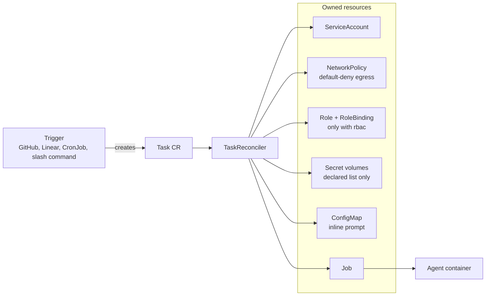
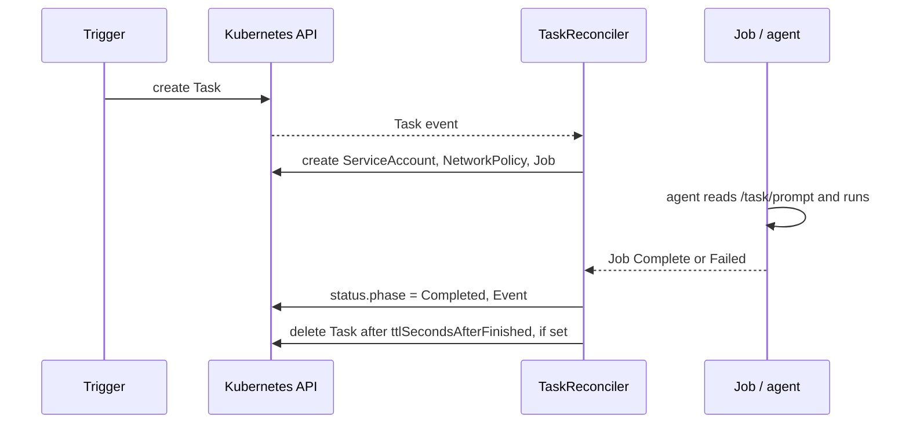

# OpenConveyor

> Kubernetes-native orchestrator for AI agents.
> Least-privilege by default. Trigger-agnostic. Agent-agnostic.

[](LICENSE)
[](https://goreportcard.com/report/github.com/openconveyor/openconveyor)
[](#status)
[](https://openconveyor.ai)

**OpenConveyor** runs AI coding agents as one-shot, hardened Kubernetes
Jobs. Each Job gets only the Secrets, the egress targets and the RBAC
that its `Task` declares. Anything that creates a `Task` is a trigger:
a Linear ticket, a GitHub issue, a cron schedule, or a slash command in
your editor. Any container that reads a prompt and exits is an agent.

---

## Table of contents

- [Why OpenConveyor](#why-openconveyor)
- [How it works](#how-it-works)
- [Quick start](#quick-start)
- [Examples](#examples)
- [Architecture](#architecture)
- [Security model](#security-model)
- [Roadmap](#roadmap)
- [Status](#status)
- [Community](#community)
- [Contributing](#contributing)
- [License](#license)

---

## Why OpenConveyor

Other projects give you a platform (OpenHands), a sandbox primitive
(`kubernetes-sigs/agent-sandbox`), or a vendor product (hosted Claude
runners, GitHub Actions). OpenConveyor targets a different set of needs:

- **Run on the cluster you have.** OpenConveyor runs on k3s on a
  homelab box, with no cloud account and no SaaS dependency.
- **Use the agent you prefer.** The orchestrator runs Claude Code, a
  fine-tuned local model, or an agent that the community publishes
  tomorrow.
- **Use the trigger you have.** Linear, GitHub, GitLab, Forgejo, a
  cron schedule, a Telegram bot, or a slash command in Claude Code can
  create a Task.
- **Get only the permissions you declare.** The default egress is
  deny-all, the default RBAC is zero, and the default Secret list is
  empty. The Task spec is the single source of truth for what an agent
  can reach.

If one of these points matches your needs, OpenConveyor is for you.

## How it works

One CRD, `Task`, describes what you want to run:

```yaml
apiVersion: openconveyor.ai/v1alpha1
kind: Task
metadata:
  name: fix-null-check
spec:
  agent:
    ref: claude-code-implementer
  prompt:
    inline: "Fix the null-pointer on line 42 of pkg/foo/bar.go and open a PR."
  permissions:
    secrets: [anthropic-api-key, github-token]
    egress:  [api.anthropic.com, api.github.com, github.com]
  resources:
    cpu:     "1"
    memory:  1Gi
    timeout: 30m
  ttlSecondsAfterFinished: 86400   # optional: delete the Task a day after it finishes
```



The controller creates these resources and owns them: a dedicated
`ServiceAccount`, a default-deny `NetworkPolicy` with the declared
egress allowlist, projected `Secret` volumes, and a one-shot `Job`. The
controller creates a `Role` and a `RoleBinding` only when the Task
declares RBAC. The Job runs with the Pod Security Standards
"restricted" defaults. When you delete the Task, Kubernetes deletes
everything that the Task owns. The phases and conditions are in
[`docs/status-reference.md`](docs/status-reference.md).

## Quick start

You need `kubectl` and a Kubernetes 1.29+ cluster: k3s, kind, EKS, or
any other distribution. The CEL admission validation on the CRDs
requires 1.29. You also need an Anthropic API key. The sample Task also
declares a `github-token` Secret, because the implementer agent mounts
it for the repository flows in [`examples/`](examples/). Any non-empty
value works for the smoke test below.

```sh
# 1. Install CRDs + controller. Pulls the v0.2.1 multi-arch image
#    (linux/amd64 + linux/arm64) from ghcr.io/openconveyor/conveyor.
kubectl apply -f https://github.com/openconveyor/openconveyor/releases/download/v0.2.1/install.yaml

# 2. Create the Task namespace and the Secrets the sample Task mounts.
#    Secrets are projected as files at /run/secrets/<name>/<key>; the
#    reference agents export them as ANTHROPIC_API_KEY / GITHUB_TOKEN.
kubectl create namespace conveyor-tasks
kubectl -n conveyor-tasks create secret generic anthropic-api-key \
  --from-literal=key="$ANTHROPIC_API_KEY"
kubectl -n conveyor-tasks create secret generic github-token \
  --from-literal=token="${GITHUB_TOKEN:-unused}"

# 3. Apply the sample AgentClasses + a Task, then watch it run.
kubectl apply -k https://github.com/openconveyor/openconveyor//config/samples?ref=v0.2.1
kubectl -n conveyor-tasks get tasks -w
```

The Task goes from `Pending` to `Running` to `Completed` in about a
minute. The first run pulls the agent image, so it takes longer. Read
the agent output with `kubectl -n conveyor-tasks logs job/task-sample`.
Run `kubectl -n conveyor-tasks describe task task-sample` to see the
Events. Every phase and reason is in
[`docs/status-reference.md`](docs/status-reference.md).

The controller is in the `conveyor-system` namespace, and the sample
kustomization puts the Task in `conveyor-tasks`.
[`docs/security-model.md`](docs/security-model.md) describes the four
guarantees that the controller applies to every Task.

<!-- vale STE.Latin = NO -->
### Install via Helm
<!-- vale STE.Latin = YES -->

From v0.2.0 the release workflow publishes the chart as an OCI artifact
next to the images. Each GitHub Release also carries the chart as a
`.tgz`:

```sh
helm install conveyor oci://ghcr.io/openconveyor/charts/conveyor \
  --version 0.2.1 \
  --namespace conveyor-system --create-namespace
```

The chart source is in [`dist/chart/`](dist/chart/). The kubebuilder
`helm/v2-alpha` plugin regenerates it from the kustomize output. The
chart installs the CRDs by default and keeps them on uninstall. Pass
`--set crd.keep=false` to change that.

### Building from source

Contributors and forks build from source:

```sh
git clone https://github.com/openconveyor/openconveyor.git
cd openconveyor

# Run the controller from your laptop against the current kubeconfig:
make install   # apply CRDs
make run       # run the controller in the foreground

# Or build + push your own image and deploy it inside the cluster:
export IMG=<registry>/conveyor:<tag>
make docker-build docker-push IMG=$IMG
make deploy                   IMG=$IMG
```

The webhook trigger adapter is optional. It enables external triggers:

```sh
# Any replica accepts webhooks; the controller and adapter share a manager.
conveyor --trigger-bind-address=:9090 --trigger-namespace=conveyor-system
```

### Controller flags

| Flag | Default | Helm value | What it does |
|---|---|---|---|
| `--trigger-bind-address` | blank (disabled) | none | Starts the webhook trigger adapter on this address. Use it with `--trigger-namespace`, the namespace that holds the HMAC Secrets. |
| `--egress-refresh-interval` | `5m` | none | Re-resolves the egress hostnames while a Task runs, so the NetworkPolicy follows DNS changes. `0` disables the refresh. |
| `--job-ttl-seconds` | `3600` | `manager.jobTTLSeconds` | Kubernetes keeps a finished Job and its logs for this many seconds. |
| `--task-ttl-seconds` | unset | `manager.taskTTLSeconds` | The controller deletes a terminal Task after this many seconds. The Task's own `spec.ttlSecondsAfterFinished` wins. Unset at both levels keeps the Task. |

## Examples

| Example | Trigger | What it proves |
|---|---|---|
| [`examples/github-issues-claude-code/`](examples/github-issues-claude-code/) | GitHub Issues webhook | Label → Task → PR |
| [`examples/linear-claude-code/`](examples/linear-claude-code/) | Linear workflow-state webhook | SaaS tracker → Task → PR |
| [`examples/github-pr-claude-code/`](examples/github-pr-claude-code/) | GitHub Pull Requests webhook | Label → Task → PR review comment (reviewer archetype) |
| [`examples/claude-code-slash-dispatch/`](examples/claude-code-slash-dispatch/) | Claude Code `/conveyor` slash command | The laptop is the trigger: no webhook, no server |
| [`examples/cronjob-reporter/`](examples/cronjob-reporter/) | Kubernetes CronJob | Scheduled Task → GitHub issue comment (reporter archetype) |

The Issues, Linear and slash-command examples drive the
`claude-code-implementer` agent. The PR example drives
`claude-code-reviewer`, and the CronJob example drives
`claude-code-reporter`. Only the trigger differs: the Task shape and
the reconciler are the same.

## Architecture



When you enable the webhook trigger adapter, it runs as a
`manager.Runnable` in the same binary, so one Deployment hosts the
reconciler and the HTTP endpoint.

See [`docs/architecture.md`](docs/architecture.md) for the full
reconciliation flow and the code map.

## Security model

Four guarantees apply to every Task. A Kubernetes primitive enforces
each one, not documentation or convention:

1. **Default-deny egress.** With an empty `spec.permissions.egress`,
   the pod has no network access, not even DNS. When you declare
   egress, the controller adds DNS to `kube-dns` and opens the targets
   on port 443 only (`spec.permissions.egressPorts` changes the ports).
2. **Default-zero RBAC.** The controller sets
   `automountServiceAccountToken=false` and creates no `Role` unless
   the Task declares `permissions.rbac`.
3. **Declared secrets only.** The controller projects each declared
   Secret as read-only files at `/run/secrets/<name>/<key>`, one file
   per Secret key. It never exposes a Secret as an environment
   variable, because `/proc` and child processes leak the environment.
4. **Hard kill.** `spec.resources.timeout` is mandatory and maps to
   `Job.spec.activeDeadlineSeconds`. The Job has `backoffLimit: 0`, so
   an expensive agent run never retries blindly.

[`docs/security-model.md`](docs/security-model.md) has the full threat
model, the verification commands and the scope boundaries.
[`docs/adr/`](docs/adr/) records the rationale behind each decision.

## Roadmap

OpenConveyor is in alpha and moves fast.

**Done:**

- ✅ **Phase 0–5** — The security baseline, AgentClass resolution with
  prompt projection, the reference implementer agent image, the HMAC
  webhook adapter, and three trigger examples.
- ✅ **Phase 6** — The reviewer agent (a labeled PR → review comments),
  with a GitHub Pull Requests example trigger.
- ✅ **Phase 7** — Scheduled Tasks with a stock `CronJob`, the reporter
  agent archetype, and the phone workflow documentation.
- ✅ **Phase 8** — Prometheus metrics (task phase transitions,
  reconcile errors, task duration, webhook request outcomes),
  structured K8s-style logs, Task `status.observedGeneration`, and
  start/complete print columns.
- ✅ **Phase 9** — The v0.1.0 release (GitHub-only scope).
- ✅ **v0.2.0** — Helm chart distribution, CEL admission validation,
  and `AgentRef.config` projection into the pod.

**Next:**

- A `conveyor-git` helper that unifies the GitHub, GitLab and Forgejo
  CLIs inside the reference agents.
- GitLab and Forgejo examples that prove git-host pluggability.
- Multi-agent reference images (Gemini, Codex, and more) on top of the
  config projection from v0.2.0.

## Status

**Alpha.** v0.2.1 is the current release. Unit and `envtest`
integration tests cover the security baseline and the trigger adapter.
The controller exposes custom Prometheus metrics on the manager's
`/metrics` endpoint. The APIs can change before v1.0. There are no
production users yet; this is pre-1.0 by design.

## Community

- **Website:** [openconveyor.ai](https://openconveyor.ai)
- **Issues & discussions:** GitHub Issues on this repository
- **Security:** Open a [GitHub security advisory][sec] for a
  vulnerability. Do not file a public issue.

[sec]: https://docs.github.com/en/code-security/security-advisories/guidance-on-reporting-and-writing/privately-reporting-a-security-vulnerability

## Contributing

We welcome issues, design critique, and PRs. Start with these
documents:

- [`docs/architecture.md`](docs/architecture.md) — how the operator
  fits together.
- [`docs/status-reference.md`](docs/status-reference.md) — every
  phase, `Ready` reason and Event that a Task can report, for triggers
  and dashboards.
- [`docs/plugin-authoring.md`](docs/plugin-authoring.md) — how to add
  a new AgentClass or ClusterTriggerClass config.
- [`docs/enterprise-auth.md`](docs/enterprise-auth.md) — short-lived
  credentials for agents (GitHub App tokens with External Secrets).
- [`docs/adr/`](docs/adr/) — the required design decisions. If your
  PR argues against one, propose a superseding ADR.
- [`docs/writing-style.md`](docs/writing-style.md) — the Simplified
  Technical English rules for prose and comments.
- [`AGENTS.md`](AGENTS.md) — the kubebuilder scaffolding conventions
  that the repo follows.

## License

OpenConveyor is available under the [Apache License, Version 2.0](LICENSE).
