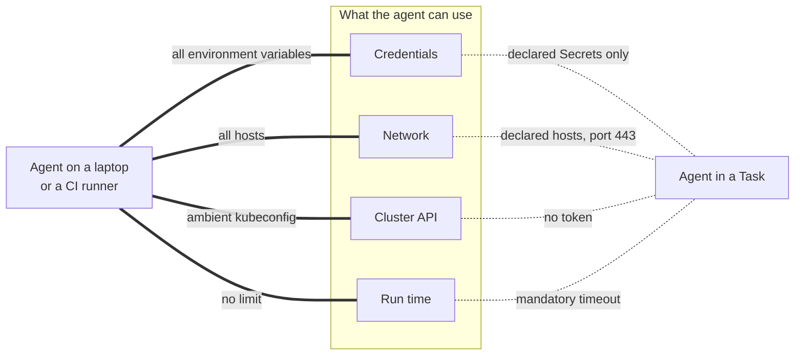
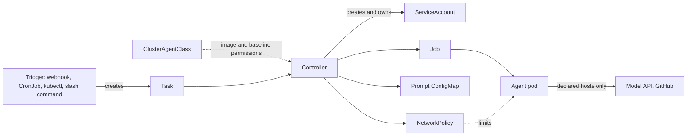
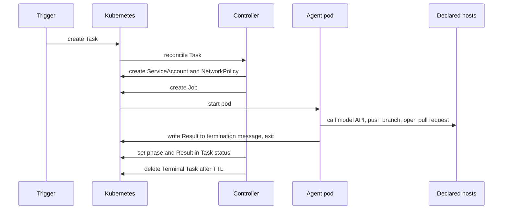
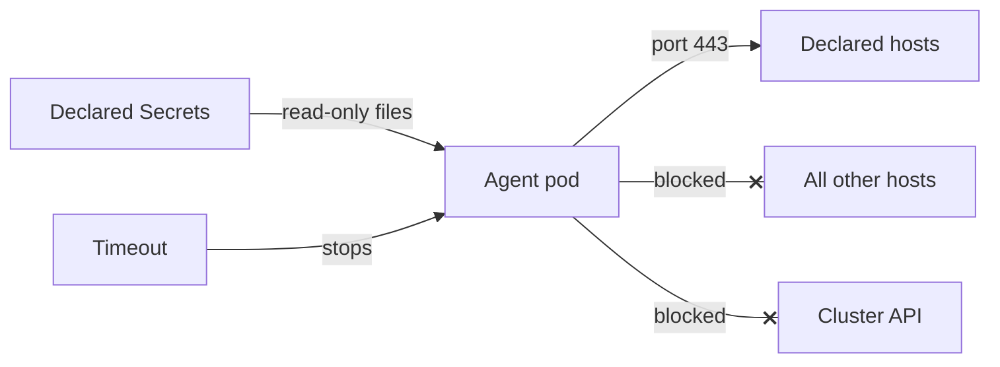

# OpenConveyor

> Run AI coding agents on your own Kubernetes cluster as one-shot,
> least-privilege Jobs. Any trigger. Any agent image.

[](LICENSE)
[](https://goreportcard.com/report/github.com/openconveyor/openconveyor)
[](#status-and-roadmap)
[](https://openconveyor.ai)

OpenConveyor is a Kubernetes operator. One `Task` resource names an
agent, a prompt, and the Secrets, hosts and API verbs that the agent
can use. The controller runs the agent once as a hardened Job that has
those permissions and no others.

## Why it exists

A coding agent is only useful when it holds real credentials: a model
API key and a token that can push branches. A laptop, a CI runner or a
long-lived pod gives the agent much more than one Task needs. A hostile
prompt or a compromised dependency can then use all of it.

OpenConveyor gives each agent only what its Task declares, and the API
server enforces that limit. The thick lines show what an agent gets on
a laptop. The dotted lines show what the same agent gets in a Task.



Hosted runners tie you to the agent and the cloud of one vendor.
`kubernetes-sigs/agent-sandbox` targets long-lived workspaces and needs
gVisor or Kata. OpenConveyor runs one-shot agents on the cluster you
have, including single-node k3s
([ADR-0002](docs/adr/0002-build-own-sandbox.md)).

## How it works

A trigger creates a `Task`. The controller turns the Task into a fixed
set of objects that the Task owns, and the Job is the last one.



The agent runs once. It reports a Result when it exits, and the
controller stores that Result in the Task status.



- **Triggers are outside the controller.** Anything that can create a
  Task is a trigger
  ([ADR-0003](docs/adr/0003-triggers-out-of-process.md)).
- **Policy comes first.** The controller creates the NetworkPolicy
  before the Job, so no pod starts without its policy.
- **There are no retries.** `backoffLimit` is 0 and `timeout` becomes
  `activeDeadlineSeconds`.
- **Status follows the Job.** The phase goes from Pending to Running,
  then to Completed, Failed or TimedOut
  ([status reference](docs/status-reference.md)).
- **One delete removes everything.** Each object has an owner reference
  to the Task and the label `openconveyor.ai/task=<name>`.

[`docs/architecture.md`](docs/architecture.md) has the full reconcile
flow and the code map.

## The three resources

**`Task`** is in a namespace and is the resource that most users write:

```yaml
apiVersion: openconveyor.ai/v1alpha1
kind: Task
metadata:
  name: fix-nil-pointer
spec:
  agent:
    ref: claude-code-implementer
  prompt:
    inline: |
      Fix the nil-pointer dereference on line 42 of foo.go and open a PR
      against the `main` branch.
  permissions:
    # api.anthropic.com and anthropic-api-key come from the AgentClass.
    secrets: [github-token]
    egress:  [api.github.com, github.com]
  resources:
    cpu:     "1"
    memory:  1Gi
    timeout: 30m
  ttlSecondsAfterFinished: 86400   # optional: delete the Task a day after it ends
```

**`ClusterAgentClass`** describes an agent: an image, the path where it
reads the prompt, and the permissions that each Task of that class
needs. Any container that reads the prompt and exits is a valid agent.
The repo ships three reference agents built on Claude Code: an
implementer, a reviewer and a reporter
([`config/samples/`](config/samples/)).

**`ClusterTriggerClass`** configures the optional webhook adapter in
the controller binary. It sets an HTTP path, an HMAC signature, payload
filters, a Task template and an optional dedupe rule.

[`docs/plugin-authoring.md`](docs/plugin-authoring.md) describes the
agent contract and all fields of the two classes.

## Quick start

You need `kubectl`, a Kubernetes 1.29+ cluster and an Anthropic API
key. The sample Task also mounts a `github-token` Secret. Any non-empty
value works for this smoke test.

```sh
# 1. Install the CRDs and the controller into conveyor-system.
kubectl apply -f https://github.com/openconveyor/openconveyor/releases/download/v0.4.0/install.yaml

# 2. Create the Task namespace and the Secrets that the sample Task mounts.
kubectl create namespace conveyor-tasks
kubectl -n conveyor-tasks create secret generic anthropic-api-key \
  --from-literal=key="$ANTHROPIC_API_KEY"
kubectl -n conveyor-tasks create secret generic github-token \
  --from-literal=token="${GITHUB_TOKEN:-unused}"

# 3. Apply the sample AgentClasses and a Task, then watch the Task.
kubectl apply -k "https://github.com/openconveyor/openconveyor//config/samples?ref=v0.4.0"
kubectl -n conveyor-tasks get tasks -w
```

The Task goes from `Pending` to `Running` to `Completed` in about a
minute. Read the agent output with
`kubectl -n conveyor-tasks logs job/task-sample`. Read the Events with
`kubectl -n conveyor-tasks describe task task-sample`.

[`docs/installation.md`](docs/installation.md) covers Helm, a build
from source, the webhook adapter and the controller flags.

## Examples

The controller, the AgentClasses and the Task shape are identical in
each example. Only the trigger changes.

| Example | Trigger | Result |
|---|---|---|
| [`phone-workflow-stack/`](examples/phone-workflow-stack/) | GitHub webhooks through Tailscale Funnel | The full GitHub flow on kind with one `make install` ([tutorial](docs/phone-workflow.md)) |
| [`github-issues-claude-code/`](examples/github-issues-claude-code/) | GitHub Issues webhook | Label an issue, get a PR |
| [`github-pr-claude-code/`](examples/github-pr-claude-code/) | GitHub Pull Requests webhook | Label a PR, get a review |
| [`github-pr-iterate/`](examples/github-pr-iterate/) | GitHub Pull Requests webhook | Label a PR, get the review addressed on the same branch |
| [`linear-claude-code/`](examples/linear-claude-code/) | Linear webhook | Move an issue, get a PR |
| [`cronjob-reporter/`](examples/cronjob-reporter/) | Kubernetes CronJob | A scheduled report as an issue comment |
| [`claude-code-slash-dispatch/`](examples/claude-code-slash-dispatch/) | Claude Code `/conveyor` command | A Task from your laptop, with no server |

## Security model

Each Task has four guarantees. A Kubernetes primitive enforces each
one, not the documentation and not the agent image.



| Guarantee | How Kubernetes enforces it |
|---|---|
| Default-deny egress | One NetworkPolicy for each Task. An empty `egress` list gives zero rules, also no DNS. |
| No RBAC | No ServiceAccount token and no bindings, unless the Task declares `permissions.rbac`. |
| Secrets as files | Read-only files at `/run/secrets/<name>/<key>`, never environment variables. |
| Hard timeout | `timeout` is mandatory and becomes `activeDeadlineSeconds`. |

The pod also runs as non-root with a read-only root filesystem, no
capabilities and the default seccomp profile.
[`docs/security-model.md`](docs/security-model.md) has the threat
model, the limits, and commands that verify each guarantee from inside
a pod.

## Status and roadmap

OpenConveyor is alpha. The current release is v0.4.0. The API is
`v1alpha1` and can change before version 1. Unit tests, envtest
tests and a kind e2e suite cover the guarantees and the trigger
adapter. Shell tests cover the reference agents. The controller
exports Prometheus metrics.

Next:

- A `conveyor-git` helper that gives the reference agents one interface
  to the GitHub, GitLab and Forgejo CLIs.
- GitLab and Forgejo trigger examples.
- Reference agent images for other models.

## Documentation

| Document | Content |
|---|---|
| [`docs/architecture.md`](docs/architecture.md) | The reconcile flow and the package that owns each part |
| [`docs/security-model.md`](docs/security-model.md) | The four guarantees, the threat model and the supply chain |
| [`docs/status-reference.md`](docs/status-reference.md) | Each phase, `Ready` reason and Event of a Task |
| [`docs/plugin-authoring.md`](docs/plugin-authoring.md) | How to write an agent or a trigger |
| [`docs/installation.md`](docs/installation.md) | Helm, source build, webhook adapter, controller flags |
| [`docs/enterprise-auth.md`](docs/enterprise-auth.md) | Short-lived credentials with External Secrets |
| [`docs/adr/`](docs/adr/) | The accepted decisions and their reasons |
| [`GLOSSARY.md`](GLOSSARY.md) | The terms of the project |
| [`CONTRIBUTING.md`](CONTRIBUTING.md) | The development commands and the pull request rules |

## Community

- **Website:** [openconveyor.ai](https://openconveyor.ai)
- **Issues and discussions:** GitHub Issues on this repository
- **Security:** report a vulnerability through a
  [GitHub security advisory][sec], not a public issue

[sec]: https://docs.github.com/en/code-security/security-advisories/guidance-on-reporting-and-writing/privately-reporting-a-security-vulnerability

## License

OpenConveyor uses the [Apache License, Version 2.0](LICENSE).
