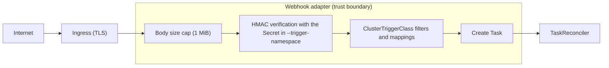

# ADR-0006: Webhook adapter trust boundary — HMAC, capped body, namespace-local secrets

- **Status:** Accepted
- **Date:** 2026-04-18
- **Deciders:** Martijn Scholten

## Context

The reference webhook adapter (Phase 4) is an HTTP endpoint. In a
typical deployment the internet can reach it, because GitHub, Linear
and GitLab POST to it. The adapter creates `Task` CRs, and the
reconciler then creates Jobs and Secret projections from them. A
compromised trigger is therefore a privilege escalation from "public
HTTP" to "agent runs on the cluster with declared secrets."

The diagram shows the trust boundary. A request that fails one step
does not reach the next step.

Several questions needed decisions before the adapter shipped:

1. Which authentication mechanism do we support? OAuth? mTLS? HMAC?
   All three?
2. Where are the HMAC signing keys?
3. How much of the payload do we accept?
4. What happens when a mapping in a `ClusterTriggerClass` fails to
   resolve?

## Decision

**1. HMAC-SHA256 only, shared secret per ClusterTriggerClass.** The
adapter validates `HMAC(secret, rawBody) == headerValue` in constant
time. There is no OAuth and no mTLS at the application layer. Users
who need stronger auth terminate it at their ingress or reverse proxy.

**2. Signing secrets are in the adapter's own namespace.** The
`ClusterTriggerClass.spec.signature.secretRef` names a Secret by name
and key; the adapter resolves it against `--trigger-namespace` (default
`conveyor-system`). Secrets never cross namespaces.

**3. The adapter caps bodies at 1 MiB.** `http.MaxBytesReader`
enforces the cap. The adapter answers a larger body with a 413.

**4. An unresolved mapping falls back to `FieldMapping.Default`, or
the adapter drops it silently.** A Task that ends up without a prompt
returns 400; we do not create a prompt-less Task and let the
reconciler complain.

## Alternatives considered

- **Allow OAuth / mTLS in-process.** Rejected for v0.1. HTTPS + HMAC
  covers Linear, GitHub, GitLab, and Forgejo, the v1 target. The
  ingress of the cluster handles mTLS better; if we add it to the
  adapter, we duplicate machinery that operators already deploy.
- **Secrets in the Task's namespace instead of the adapter's.**
  Rejected. The adapter does not know the namespace of the Task
  *until* it applies the mappings. A signature check after the
  mappings run creates a time-of-check/time-of-use gap.
- **Unbounded bodies.** Rejected. A misbehaving sender (or a forged
  one) can exhaust memory in a request loop. 1 MiB is ~100× the
  largest real webhook payload that we have seen in practice.
- **Fail loud on any unresolved mapping.** Rejected as a default.
  Webhook payloads vary by action type: an "issue" event has no
  `pull_request`, and the reverse. When the adapter drops an
  unresolvable mapping, a single `ClusterTriggerClass` works across
  actions.

## Consequences

- **To rotate a webhook secret, you edit the referenced Secret only.**
  There is no OpenConveyor restart and no CRD edit. The next request
  reads the new value.
- **A ClusterTriggerClass without filters is dangerous.** Any valid
  signature produces a Task. Document `filters: [...]` as a de-facto
  requirement in the plugin-authoring guide. Consider a CEL-based
  admission check later.
- **HMAC is only as strong as the shared secret.** Document the
  minimum length (>= 32 bytes of entropy) and the rotation cadence in
  the security model.
- **The adapter cannot distinguish a well-formed "wrong-event" webhook
  from malicious traffic.** A GitHub "issue closed" event with a valid
  signature receives a 202 (accepted, filtered). This is intentional:
  the attacker already proved that they have the secret, so the
  signature and the filter together are the gate.

## References

- `internal/trigger/handler.go`
- `internal/trigger/signature.go`
- `internal/trigger/mapping.go`
- `api/v1alpha1/clustertriggerclass_types.go`
- `config/samples/conveyor_v1alpha1_clustertriggerclass.yaml`
