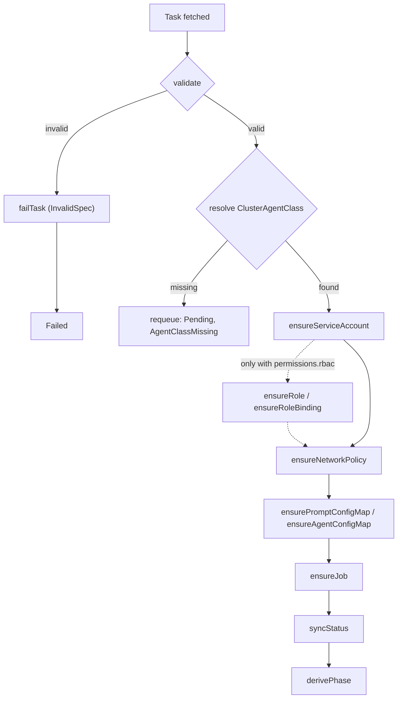

# Architecture

OpenConveyor is one controller-runtime manager. It reconciles one CRD
(`Task`) into a fixed set of owned resources. Each other part of the repo is one
of two things. It is (a) a pure function that generates a piece of a
Kubernetes object, or (b) a reference trigger or agent. A reference
trigger or agent is next to the core but shares no runtime with it.

## Reconciliation flow

The steps behave as follows:

- `ensureServiceAccount` always runs. It sets `automount=false` on the
  ServiceAccount.
- `ensureRole` and `ensureRoleBinding` create objects only when
  `permissions.rbac` is not empty.
- `ensureNetworkPolicy` always runs. It writes a deny-all policy when
  the egress list is empty.
- `ensureJob` writes a hardened PodSpec. The Job is immutable after
  the create.
- `syncStatus` calls `derivePhase`, which reads the Job conditions.

The order matters. The controller creates the NetworkPolicy before the
Job, so the CNI has the policy in place before the scheduler places the
first pod. Without this order, some CNIs give the pod a short
default-allow window before they apply the policy.

## Code map

| Concern | Path |
|---|---|
| CRD types | `api/v1alpha1/` |
| Reconciler | `internal/controller/task_controller.go` |
| Resource builders (Job, SA) | `internal/controller/build.go` |
| Policy generators (pure) | `internal/policy/` |
| NetworkPolicy | `internal/policy/networkpolicy.go` |
| Role + RoleBinding | `internal/policy/rbac.go` |
| Secret volume projection | `internal/policy/secrets.go` |
| Shared labels | `internal/policy/labels.go` |
| Manager entrypoint | `cmd/main.go` |

The policy package is pure by design. It does no cluster I/O, except
DNS resolution through an injectable `Resolver` interface. This purity
makes the package table-testable against fixed inputs.

## Resource ownership

Each created object has an `ownerReference` to the `Task`. When you
delete the Task, the standard Kubernetes garbage collector deletes its
SA, Role, RoleBinding, NetworkPolicy and Job. The reconciler never
writes an object without an owner. It always calls
`controllerutil.SetControllerReference` before it creates an object.

The shared label schema (`internal/policy/labels.go`) lets an operator
see all objects of a Task with one command:
`kubectl get all,networkpolicies,roles,rolebindings -l
openconveyor.ai/task=<name>`.

## Status model

`Task.status.phase` is a coarse lifecycle marker:

- **Pending** — The controller accepted the Task; the Job has not
  started yet.
- **Running** — The Job has an active pod or a start time.
- **Completed** — The Job reported `JobComplete`.
- **Failed** — The Job reported `JobFailed` with a reason other than
  the deadline, or the spec failed validation.
- **TimedOut** — The Job reported `JobFailed` with `DeadlineExceeded`.

The `Ready` condition in `status.conditions` gives more detail. Its
reason comes from a small closed enum (`AgentClassMissing`,
`InvalidSpec`, `EgressResolveFailed`, …). Write triggers that watch the
conditions, not the phase strings.
[`status-reference.md`](status-reference.md) lists each phase, reason,
message and Event.

The controller never reconciles a terminal Task into a Job again. If
the Task sets `spec.ttlSecondsAfterFinished`, or the controller runs
with `--task-ttl-seconds`, the reconciler requeues the Task until the
finish time plus the TTL. Then it deletes the Task, and the garbage
collector deletes the owned resources through their controller
references. Without a TTL at either level, the Task stays until a user
deletes it.

The controller also publishes the same transitions as Kubernetes
Events on the Task (`events.k8s.io/v1`, reporting controller
`conveyor`). Thus `kubectl describe task <name>` shows the history. The
controller sends one `Normal` Event for each phase change (`Pending`,
`Running`, `Completed`). It sends a `Warning` Event for each unwanted
result (`Failed`, `TimedOut`, `InvalidSpec`, `EgressResolveFailed`,
`AgentClassMissing`). The Event reason is the condition reason, and
the Event message is the condition message. The controller sends no
Event when a reconcile leaves the status unchanged, so the periodic
requeue of a waiting Task does not flood the Events.

## What lives outside the controller

Triggers and agents run out of process. They touch only the Kubernetes
API, never the controller directly:

- **Triggers** create Task CRs. The webhook adapter runs as a
  `manager.Runnable` in the same manager binary, enabled with
  `--trigger-bind-address`. Other triggers (cron, slash-command,
  custom scripts) have no code on the OpenConveyor side.
- **Agents** are plain container images that a `ClusterAgentClass`
  references. The contract is "read the prompt at `/task/prompt`, exit
  with the right code." Each other behavior is specific to the agent.

By design, a new trigger or a new agent never requires a change in
`internal/`.
