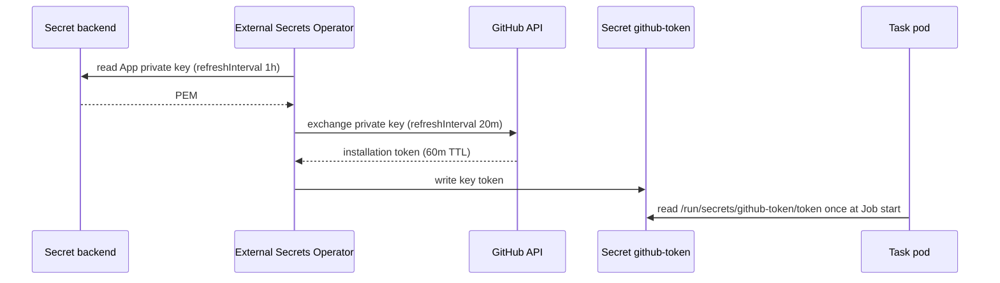

# Enterprise auth: short-lived credentials for agents

The weakest credential in an agent pipeline is usually a long-lived
personal access token in a cluster Secret. This page documents the
recommended alternative. Create short-lived, tightly scoped tokens
*outside* the Task. Then let the secrets-as-files contract of
OpenConveyor deliver them unchanged.

This pattern requires no change to OpenConveyor. It composes three
existing pieces:

1. OpenConveyor projects declared Secrets as read-only files at
   `/run/secrets/<name>/<key>` (ADR-0004). Agents read them **once, at
   Job start**. Thus a Secret whose value rotates underneath a running
   Task does no harm. A token that expires shortly *after* the Task's
   timeout is ideal.
2. [External Secrets Operator](https://external-secrets.io) (ESO)
   keeps cluster Secrets in sync with an external backend. It can also
   run **generators** that create fresh credentials on each refresh.
3. GitHub Apps issue installation tokens that expire after 60 minutes.
   The tokens reach only the repositories where you installed the App.

<!-- vale STE.Latin = NO -->
## The pattern: GitHub App installation tokens via ESO
<!-- vale STE.Latin = YES -->

Instead of a PAT, store the **private key** of the GitHub App in your
secret backend. The `GithubAccessToken` generator of ESO exchanges it
for a fresh installation token on each refresh. The resulting `Secret`
keeps the exact name and key that the reference agents expect
(`github-token` / `token` → `/run/secrets/github-token/token` →
`$GITHUB_TOKEN`).



```yaml
# 1. Mirror the App private key (plaintext PEM) from your backend.
apiVersion: external-secrets.io/v1
kind: ExternalSecret
metadata:
  name: github-app-private-key
  namespace: conveyor-tasks
spec:
  refreshInterval: 1h
  secretStoreRef:
    name: <your-secret-store>        # ClusterSecretStore or SecretStore
    kind: ClusterSecretStore
  target:
    name: github-app-private-key
    creationPolicy: Owner
  data:
    - secretKey: privateKey
      remoteRef:
        key: <path/to/github-app-private-key>   # plaintext PEM, no property selector
---
# 2. Generator: exchanges the private key for a 60m installation token.
apiVersion: generators.external-secrets.io/v1alpha1
kind: GithubAccessToken
metadata:
  name: github-app-token
  namespace: conveyor-tasks
spec:
  appID: "<your-app-id>"
  installID: "<your-installation-id>"
  auth:
    privateKey:
      secretRef:
        name: github-app-private-key
        key: privateKey
---
# 3. The Secret the agents actually mount. Name and key are load-bearing:
#    the reference agents discover /run/secrets/github-token/token and
#    export it as $GITHUB_TOKEN.
apiVersion: external-secrets.io/v1
kind: ExternalSecret
metadata:
  name: github-token
  namespace: conveyor-tasks
spec:
  refreshInterval: 20m
  target:
    name: github-token
    creationPolicy: Owner
  dataFrom:
    # The generator emits key "token", preserving the expected path.
    - sourceRef:
        generatorRef:
          apiVersion: generators.external-secrets.io/v1alpha1
          kind: GithubAccessToken
          name: github-app-token
```

A Task then declares the Secret exactly as before:

```yaml
spec:
  permissions:
    secrets:
      - github-token
```

## The timing invariant

Agents read the token once at Job start, so the token must outlive the
longest Task that can start with it. Select values so that:

```
refreshInterval + max Task timeout < token TTL
```

With the values above, a token is at most 20 minutes old when a Task
starts. That leaves ≥ 40 minutes of validity, well above a 30-minute
`spec.resources.timeout`. If you increase your Task timeouts, decrease
the refresh interval (or the reverse) and check the sum again. GitHub
fixes the TTL of an App installation token at 60 minutes.

## Why this beats a PAT

- **Blast radius**: a leaked installation token expires within the
  hour and reaches only the repositories where you installed the App. A
  leaked PAT is the user's whole account until someone notices.
- **Scoping**: you declare the App permissions once, centrally
  (contents, pull requests, issues — whatever your agents need). The
  agents do not inherit them from a human's role.
- **Audit**: API activity shows as the App, not as a person. Thus the
  audit logs separate the agent actions.
- **Zero agent changes**: the reference agents see no difference. The
  file path and the env var are identical to the static-secret setup.

## Other backends, same shape

The pattern applies to any credential that a controller can create
outside the Task. An ESO generator or a Vault dynamic-secrets engine
can produce short-lived database credentials, cloud STS tokens, or
registry credentials. All of them arrive the same way: a rotating
Secret with a stable name, projected read-only into the Job. The
invariant above is the only thing that you must derive again for each
credential type.

## See also

- [`security-model.md`](security-model.md) — guarantee 3, declared
  secrets only.
- [`adr/0004-secrets-as-files.md`](adr/0004-secrets-as-files.md) — why
  secrets are files, never env vars.
- [ESO `GithubAccessToken` generator docs](https://external-secrets.io/latest/api/generator/github/)
