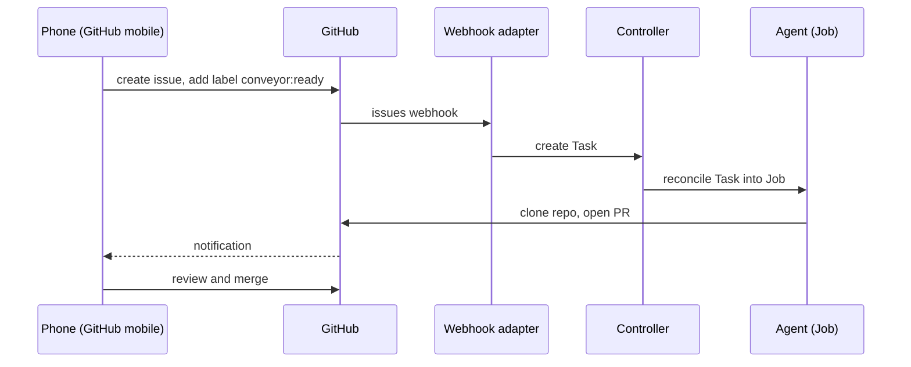

# Phone Workflow

The GitHub Issues trigger of OpenConveyor works from your phone. You
create an issue in GitHub mobile and label it. Then an agent runs on
its own: it clones the repo, does the work, and opens a PR. You review
the PR on your phone, merge it, and send the next task.

## Prerequisites

- The webhook adapter is reachable from the internet (a tunnel, a load
  balancer, or Cloudflare Tunnel).
- A GitHub webhook on your repo points at the adapter (see
  `examples/github-issues-claude-code/README.md`).
- The `conveyor:ready` label exists on the repo.
- The Secrets `github-token` and `anthropic-api-key` exist in the
  `conveyor-tasks` namespace.

## Step-by-step



### 1. Create an issue on your phone

Open the GitHub mobile app, go to your repo, and create a new issue.
The issue body is the prompt. Write it as you speak to a developer:

> Set up a Go project with a basic HTTP server, Dockerfile, and
> Makefile. Use chi for routing. Open a PR against main.

### 2. Label the issue

Add the `conveyor:ready` label to the issue. This label is the gate.
The webhook starts only when you apply this label, so you can draft an
issue without the label safely.

### 3. Agent runs

GitHub sends the webhook, the adapter creates a Task, and the
controller reconciles it into a hardened Job. The agent clones your
repo, runs Claude with your prompt, and opens a PR if it makes
changes.

GitHub sends a notification to your phone when the agent creates the
PR.

### 4. Review and merge

Open the PR in GitHub mobile. Review the changes, write comments, or
approve and merge. GitHub deletes the agent's branch after the merge
(if you enabled that GitHub setting).

### 5. Dispatch the next task

Create another issue with the next instruction:

> Add user authentication with JWT. Use the existing chi router.
> Include middleware and a /login endpoint. Open a PR against main.

Label it `conveyor:ready`. The cycle repeats.

## Iterative development workflow

This pattern works well when you build a project in steps:

1. **Scaffold** — "Set up the project structure with Go modules,
   Dockerfile, CI, and a basic health endpoint."
2. **Feature** — "Add a /users CRUD API with SQLite storage."
3. **Feature** — "Add input validation and error handling to the
   /users endpoints."
4. **Fix** — "The POST /users endpoint returns 500 when the email
   is duplicate. Add a unique constraint and return 409."
5. **Refactor** — "Extract the SQLite queries into a repository
   pattern."

Each step is one issue, one agent run, one PR. You review each PR on
your phone between the steps.

## Tips

- **Be specific in the prompt.** Include file names, function names,
  and the expected behavior. The agent works better with concrete
  instructions than with vague requests.
- **Refer to previous PRs.** "Building on the changes from PR #3,
  add pagination to the /users endpoint."
- **Set `TARGET_REPO` and `TARGET_BRANCH`.** The trigger template
  in `examples/github-issues-claude-code/trigger.yaml` maps
  `repository.clone_url` to `config.TARGET_REPO` and
  `repository.default_branch` to `config.TARGET_BRANCH`. The
  controller projects them into the agent container as env vars. This
  is how the agent clones the correct repo.
- **Check the logs if the PR does not appear.** Find the Task name
  with `kubectl -n conveyor-tasks get tasks` and follow the Job logs:
  ```sh
  kubectl -n conveyor-tasks logs -f job/<task-name>
  ```

## Alternative: GitHub Actions workflow_dispatch

If your cluster is not reachable from the internet (no tunnel), you
can use GitHub Actions as the dispatch mechanism:

1. Create a workflow with `on: workflow_dispatch` and a `prompt`
   input field.
2. The workflow runs `kubectl apply` with the prompt embedded in a
   Task YAML.
3. This requires a self-hosted runner with cluster access, or a
   kubeconfig in a GitHub Secret.

This is not a reference example yet. The pattern is identical to the
`claude-code-slash-dispatch` example: `kubectl apply` with a templated
Task YAML.
