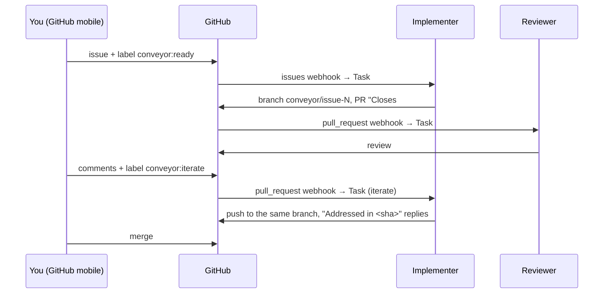

# Phone workflow

You can drive OpenConveyor from the GitHub mobile app. Write an issue
and add a label, and an agent opens a pull request. Review the PR on
your phone. When you want changes, add a second label, and the agent
updates the same PR. Then merge.

This tutorial uses the GitHub flow of the
[`phone-workflow-stack`](../examples/phone-workflow-stack/) example. Its
README installs everything: the controller with the trigger adapter, the
agent classes, the trigger classes, the Secrets, the webhooks and the
Tailscale Funnel. Each step below shows the tap in the GitHub app and
the `gh` command that does the same.

## Before you start

- You installed the stack and registered the three webhooks. See
  [the stack README](../examples/phone-workflow-stack/README.md#install).
- The target repository has a default branch and the labels
  `conveyor:ready`, `conveyor:review` and `conveyor:iterate`. The
  scripts `init-repo.sh` and `create-labels.sh` of the stack do this.
- `REPO` names the repository in the commands, for example
  `REPO=scholtenmartijn/openconveyor-test`.

## The loop



Each label is a gate. Nothing runs until you add `conveyor:ready` or
`conveyor:iterate`. While a run for an issue or a PR is active, another
label event for it starts nothing.

## 1. Write the issue

In the app, open the repository, tap **Issues**, then **+**. Write the
title and the body as you write to a developer. The implementer reads
the title, the body, the labels and the comments of the issue.

```sh
gh issue create -R "$REPO" \
  --title "Add a CONTRIBUTING.md that explains how to propose a change" \
  --body "Write a short CONTRIBUTING.md at the repository root. Explain how to propose a change: open an issue that describes it, add the label conveyor:ready, then review the pull request that the OpenConveyor implementer opens. Keep it under 30 lines."
```

Write the task, not the git steps. The implementer creates the branch,
the commit and the PR itself. It ignores an instruction such as "open a
PR against main".

## 2. Add the label `conveyor:ready`

On the issue, tap **Labels** and select `conveyor:ready`.

```sh
gh issue edit <issue> -R "$REPO" --add-label conveyor:ready
```

GitHub sends the `issues` webhook, and the adapter creates a Task. On
the cluster you can follow it:

```sh
kubectl -n conveyor-tasks get tasks -L openconveyor.ai/issue-number
kubectl -n conveyor-tasks logs -f job/<task>
```

## 3. Read the pull request

After a few minutes, the issue has a comment from the implementer:
`Opened https://github.com/<owner>/<repo>/pull/<n>`. The PR comes from
the branch `conveyor/issue-<issue>`. Its body ends with `Closes
#<issue>` and the footer `Opened by the OpenConveyor implementer`. The
PR has the label `conveyor:review`, so the reviewer agent posts a review
a few minutes later.

```sh
gh pr view <pr> -R "$REPO" --json title,headRefName,labels,closingIssuesReferences
gh pr view <pr> -R "$REPO" --comments
```

The Task also has the PR link in its Result:

```sh
kubectl -n conveyor-tasks get task <task> -o jsonpath='{.status.result.summary}{"\n"}'
kubectl -n conveyor-tasks get task <task> \
  -o jsonpath='{.status.result.links[?(@.name=="pull-request")].url}{"\n"}'
```

## 4. Ask for changes with `conveyor:iterate`

Read the diff in the **Files changed** tab. Comment on a line, or write
a comment on the PR. The review of the reviewer agent also counts. Then
tap **Labels** and select `conveyor:iterate`.

```sh
gh pr comment <pr> -R "$REPO" --body "Add a short section about the review labels."
gh pr edit <pr> -R "$REPO" --add-label conveyor:iterate
```

The implementer checks out the PR branch and reads the unresolved
review threads, plus the comments and the reviews since its last push.
It pushes a new commit to the same branch. It replies `Addressed in
<sha>.` on each line comment that it addressed. It does not resolve the
threads: you resolve them after you check the change.

Then it removes `conveyor:iterate`, so that you can add it again for the
next round. It also removes and adds `conveyor:review`, so the reviewer
reviews the new commit.

```sh
gh pr view <pr> -R "$REPO" --json commits,labels --jq '{commits: [.commits[].messageHeadline], labels: [.labels[].name]}'
```

Repeat this step until you like the change.

## 5. Merge

Tap **Merge pull request**. The merge closes the issue, because the PR
body says `Closes #<issue>` and the PR targets the default branch.

```sh
gh pr merge <pr> -R "$REPO" --squash --delete-branch
gh issue view <issue> -R "$REPO" --json state
```

Write the next issue, and the loop starts again.

## When something goes wrong

The Task status says what happened. The `Result` condition and
`status.result.summary` hold the reason that the agent reported, for
example `claude made no change in the repository; nothing to commit`.

```sh
kubectl -n conveyor-tasks get tasks -o wide
kubectl -n conveyor-tasks describe task <task>
```

| Symptom | Cause | Fix |
|---|---|---|
| No Task after the label | The webhook delivery failed | On GitHub, open **Settings → Webhooks → Recent Deliveries**. A `401` means that the secret differs; a delivery error after a Funnel start means a cold start: redeliver after a minute. |
| The adapter answers `202 {"duplicate": true}` | A Task for the issue or the PR is active | Wait until it ends, then add the label again. |
| The Task is `Failed` with "no change" | Claude found nothing to change | Make the issue more specific, and add the label again. |
| The iteration says `Nothing to address` | No unresolved thread and no comment after the last push | Write a comment first, then add `conveyor:iterate`. |
| No review appears | The label `conveyor:review` is missing on the repository | Run `scripts/create-labels.sh` of the stack. |
| The agent log shows `dial tcp …:443: i/o timeout` for `api.github.com` | GitHub rotates the IPs of its API. The NetworkPolicy allows the IPs from the last DNS lookup, and the controller looks again every 5 minutes | Add the label again. See [default-deny egress](security-model.md#1-default-deny-egress). |

## Tips

- Write one change in each issue. A small issue gives a PR that you can
  review on a phone.
- Name the files and the expected behavior in the issue. Refer to
  earlier PRs by number.
- Comment on a line when the change is local. The reply `Addressed in
  <sha>` then shows which commit made it.
- A finished Task never blocks a new run. To run an issue again, remove
  the label and add it again. The implementer reuses the open PR of the
  issue.
