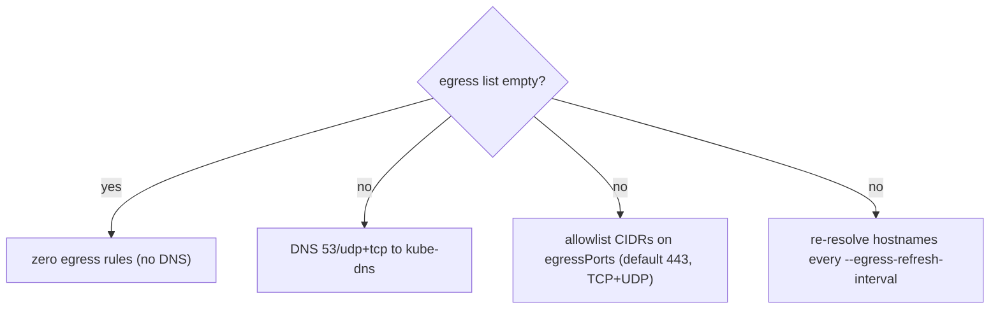

# Security Model

OpenConveyor exists for one difference. On one side: _"we documented
the safe way to run agents."_ On the other side: _"the API server
refuses to give the agent anything it did not explicitly ask for."_
OpenConveyor makes four hard guarantees.
Kubernetes primitives enforce all four, not the agent image and not the
docs.

## The four guarantees

### 1. Default-deny egress

Each Task gets a `NetworkPolicy` that applies
`PolicyTypes: [Ingress, Egress]` to its pod. When
`spec.permissions.egress` is empty, the policy has **zero egress
rules**. The pod cannot reach anything, not even DNS.

When the Task declares egress, the controller adds DNS to
`kube-system/k8s-app=kube-dns` on 53/udp+tcp. It also adds the
allowlisted CIDRs and hostnames on **port 443 only** (TCP and UDP; UDP
for HTTP/3). A Task that needs other ports lists them in
`spec.permissions.egressPorts`. That list replaces the default for each
allowlist entry; the DNS rule keeps port 53 in all cases. There is no
"all ports" setting. Ports are a separate field, not a `:port` suffix
on an entry, because IPv6 CIDRs contain colons.



The controller resolves hostnames to IPs at reconcile time. That is a
snapshot, and CDN and anycast records rotate. Thus, while a Task with
hostnames in its allowlist is not terminal, the controller re-resolves
them every `--egress-refresh-interval` (default `5m`, `0` disables the
refresh). It updates the NetworkPolicy when the set changed. Between
refreshes the pod continues to connect to the previous IPs. The policy
update cuts the connections to an IP that left the set.

For FQDN-level enforcement, install Cilium and replace the policy
generator with `CiliumNetworkPolicy`. That is the documented upgrade
path.

See `internal/policy/networkpolicy.go` and the Phase 2 envtest in
`internal/controller/task_controller_test.go`.

### 2. Default-zero RBAC

`pod.spec.automountServiceAccountToken` is `false` unless the Task
declares `spec.permissions.rbac`. Without an ambient token in
`/var/run`, a compromised agent cannot make accidental cluster API
calls. The Task's ServiceAccount carries the same
`automountServiceAccountToken` value. Thus a pod that someone else
points at that SA gets no token either. The reconciler restores both
values if someone changes them outside the reconciler.

When the Task declares RBAC, the reconciler creates a namespaced
`Role` + `RoleBinding` that contain only the listed verbs. Otherwise
the ServiceAccount has no permissions. The `RoleBinding` is the only
object that grants it anything.

Verify with `kubectl auth can-i --list --as=system:serviceaccount:<ns>:<task>`.

### 3. Declared secrets only

`spec.permissions.secrets` is a list of Secret names. The reconciler
projects each Secret as a read-only volume at `/run/secrets/<name>/`,
with one file per Secret key: `/run/secrets/<name>/<key>`. The
controller never exposes a secret through an env var. The tradeoff:

- Env vars are in `/proc/<pid>/environ`, and each child process
  inherits them. A subprocess that crashes to stderr with its env
  included leaks them.
- Files have POSIX permissions and are explicit. The agent must read
  them on purpose; they do not travel with `exec`.

The controller does not mount a Secret that the Task does not list.
`ls /run/secrets` in a zero-secret Task is empty.

Agents read secrets once at Job start, so the values can rotate
underneath without effect. Thus short-lived credentials that an
external system creates are a direct upgrade over static PATs. One
example is GitHub App installation tokens that External Secrets
Operator refreshes. See [`enterprise-auth.md`](enterprise-auth.md).

### 4. Hard kill

Each Task must set `spec.resources.timeout`. The controller rejects a
Task without one with `reason=InvalidSpec`. The value maps to
`Job.spec.activeDeadlineSeconds`. Thus a runaway agent that burns
tokens has a wall-clock limit.

Also: `backoffLimit: 0`. Agent runs are expensive; the Job never
retries blindly.

## Pod hardening (belt and suspenders)

Each Job pod runs with these values at **pod** level
(`spec.securityContext`):

- `runAsNonRoot: true`, `runAsUser: 65532`, `runAsGroup: 65532`
- `seccompProfile.type: RuntimeDefault`
- `restartPolicy: Never`

and with these values on the agent **container**
(`containers[].securityContext`):

- `runAsNonRoot`, `runAsUser`, `runAsGroup` and `seccompProfile`
  again, so the container stays hardened even if an admission mutation
  removes the pod-level block
- `readOnlyRootFilesystem: true` (plus an `emptyDir` at `/tmp`)
- `allowPrivilegeEscalation: false`
- `capabilities.drop: [ALL]`

Identity and seccomp are on the pod for two reasons. Pod-level values
also apply to containers that a mesh injects later (service-mesh
sidecars). The Pod Security Standards "restricted" profile also reads
them there. The remaining three fields exist only on containers. The
controller sets all of these values, independent of cluster-level Pod
Security admission. An agent image that refuses to start under these
values does something that we forbid on purpose.

## Controller permissions

The manager's own ClusterRole comes from `+kubebuilder:rbac` markers
(`internal/controller/task_controller.go`,
`internal/trigger/handler.go`). Two entries need an explanation:

- **`secrets` / `get`, cluster-wide.** Only the trigger adapter
  (ADR-0006) uses it, to read the HMAC key that a `ClusterTriggerClass`
  references, from the adapter's own namespace. The manager's client
  cache is off for Secrets (`cmd/main.go`). Thus the controller never
  opens a cluster-wide Secret watch and never holds a Secret in memory
  beyond one lookup. There is no `list` or `watch` verb.
- **`clustertriggerclasses` / `get;list;watch`.** The webhook adapter
  uses it for route discovery. The informer cache serves it.

## Threat model

**In scope.** A compromised agent image, or an agent with a hostile
prompt, must not be able to:

- Touch secrets that it did not declare.
- Call the k8s API beyond the verbs that it declared.
- Connect to hosts that are not in its egress allowlist.
- Exceed its declared wall-clock timeout.
- Keep state beyond the Job's lifetime (read-only rootfs; TTL-based
  Job cleanup).

**Out of scope.** OpenConveyor trusts the container runtime.
NetworkPolicy cannot defend against a kernel exploit, a containerd CVE,
or an agent that owns the node directly. For untrusted agent code, pair
OpenConveyor with `RuntimeClass=gvisor` or `kata` at the pod spec
level. Or replace the Job backend with the sandboxed CRD of
`agent-sandbox` when we add that as an alternative (deferred).

We also do not defend against a malicious user with `create tasks`
RBAC. We trust Task authors to ask only for what they need. The
cluster operator audits the declared permissions.

## Supply chain

Each release (`release.yml`, on a `v*` tag) runs the same lint, unit,
e2e, chart and agent-image workflows that a PR gets, before it pushes
anything. The workflows pin each `uses:` in `.github/workflows/` to a
commit SHA, with the version as a trailing comment (dependabot keeps
them current). The release pushes the four images (`conveyor` and the
three reference agents) with a BuildKit provenance attestation and an
SBOM. It signs them keyless with cosign against the workflow's OIDC
identity. `govulncheck` runs on each PR.

Verify an image before you deploy it:

```sh
IMAGE=ghcr.io/openconveyor/conveyor:v0.3.0

# Signature: issued to this repo's release workflow for a v* tag.
cosign verify "$IMAGE" \
  --certificate-oidc-issuer https://token.actions.githubusercontent.com \
  --certificate-identity-regexp '^https://github.com/openconveyor/openconveyor/\.github/workflows/release\.yml@refs/tags/v'

# SBOM and provenance attached to the multi-arch manifest.
docker buildx imagetools inspect "$IMAGE" --format '{{ json .SBOM }}'
docker buildx imagetools inspect "$IMAGE" --format '{{ json .Provenance }}'
```

A tag that fails `cosign verify` did not come from the release workflow
of this repository. The same commands work for
`ghcr.io/openconveyor/agent-claude-{implementer,reviewer,reporter}`.

## Verification

From a Task pod (run `kubectl debug`, or edit the image to include
`curl`/`sh`):

```sh
curl -v https://example.com                 # should fail: no egress
curl -v https://api.anthropic.com           # should work when declared
ls /run/secrets                             # should list only declared secrets
cat /var/run/secrets/kubernetes.io/serviceaccount/token  # should not exist
```

From outside the cluster:

```sh
kubectl auth can-i --list \
  --as=system:serviceaccount:<ns>:<task>    # only declared verbs

kubectl get networkpolicy <task> -o yaml    # deny-all ingress; declared egress only
```

The `envtest` suite covers the positive path (the controller creates
the policy objects correctly). The e2e suite (`make test-e2e`, kind)
covers the negative path: a Task with no egress whose agent runs
`wget https://example.com` must end `Failed` or `TimedOut`
(`test/e2e/testdata/task_egress_denied.yaml`).

The e2e spec works around one caveat and does not fix it. The CNI of
kind (kindnet with kube-network-policies) starts to filter a pod's
traffic only after it has indexed the pod IP. That happens about one
second after the container starts. The CNI accepts a connection that
opens inside that window for its lifetime.

The controller already creates the
NetworkPolicy before the Job, so nothing on its side can shrink the
window. The window is a property of the CNI. CNIs that program the
policy at sandbox creation (Calico, Cilium) do not have it. Select
your CNI accordingly for production clusters.
