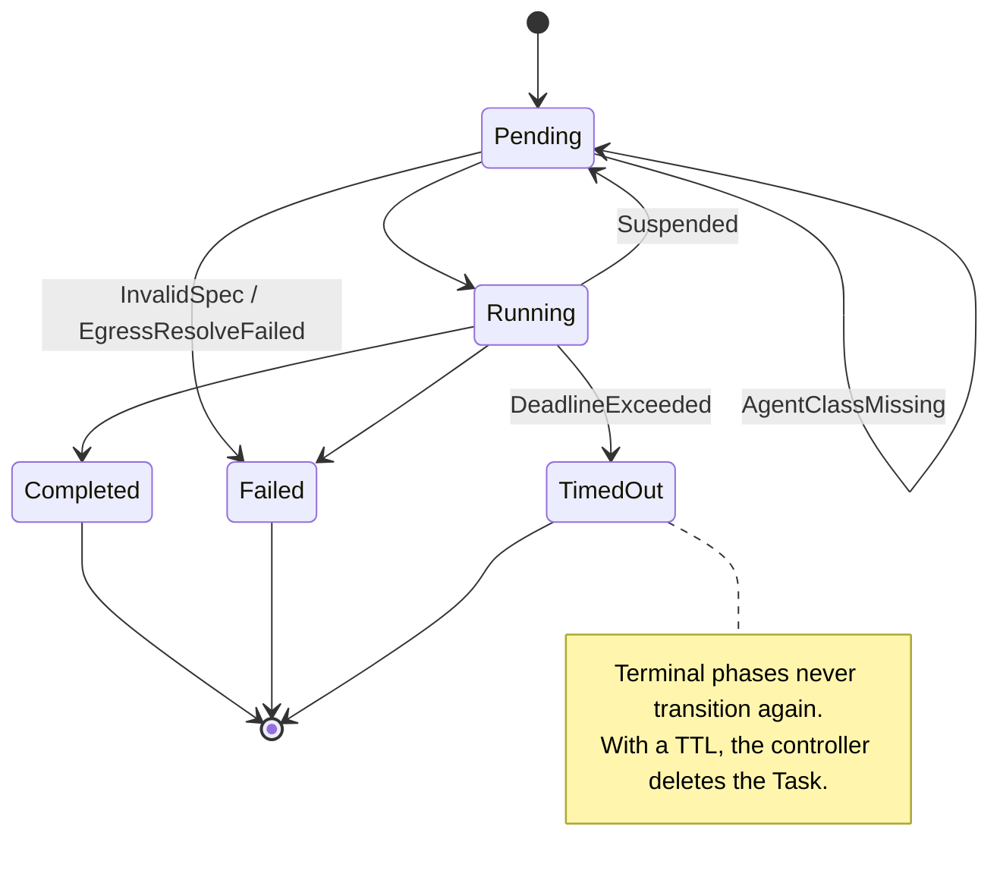

# Task status reference

This page lists what `Task.status` can say, and what each value means.
It derives from `api/v1alpha1/task_types.go` and the reason constants
in `internal/controller/status.go`. If they disagree, the code wins and
this page has a bug.

Write triggers and dashboards that **watch `status.conditions`, not
`status.phase`**. The phase is a coarse marker; the `Ready` condition
carries the reason and a message for humans.

## Phases

`status.phase` is one of five values. The last three are **terminal**:
the controller never reconciles a terminal Task into a Job again (see
[`GLOSSARY.md`](../GLOSSARY.md), *Terminal Task*).

| Phase | Meaning | Terminal |
|---|---|---|
| `Pending` | Accepted; the Job has no running pod yet, the Job carries `Suspended=True`, or the Task waits for its `ClusterAgentClass` | no |
| `Running` | The Job has an active pod or a start time | no |
| `Completed` | The Job reported `Complete` (or `SuccessCriteriaMet`) | yes |
| `Failed` | The Job reported `Failed` for a reason other than its deadline, or the controller could not turn the spec into a Job | yes |
| `TimedOut` | The Job reported `Failed` with reason `DeadlineExceeded`: `spec.resources.timeout` elapsed | yes |

An empty phase means that the controller has not reconciled the Task
yet.

### State machine



Terminal phases never transition again. With a TTL
(`spec.ttlSecondsAfterFinished` or `--task-ttl-seconds`), the
controller deletes the Task when the TTL elapses.

`Pending` with reason `AgentClassMissing` is a wait state, not a
failure. The Task continues as soon as the referenced
`ClusterAgentClass` appears.

## The `Ready` condition

There is one condition type, `Ready`. Its `status` follows the phase:
`Unknown` while the Task is not terminal, `True` on `Completed`,
`False` on `Failed` and `TimedOut`. The `reason` is a closed set:

<!-- vale STE.Passive = NO -->
| Reason | Phase | Status | Message | Set when |
|---|---|---|---|---|
| `AgentClassMissing` | `Pending` | `Unknown` | `Waiting for ClusterAgentClass "<ref>" to be created` | `spec.agent.ref` does not exist yet; the controller checks again on a watch and every 30 s |
| `Pending` | `Pending` | `Unknown` | `Waiting for pod to start` | The Job exists but has no start time or active pod |
| `Suspended` | `Pending` | `Unknown` | Job condition message, or `Job is suspended` | The Job carries `Suspended=True` |
| `Running` | `Running` | `Unknown` | `Job is running` | The Job has an active pod or a start time |
| `Completed` | `Completed` | `True` | Job condition message, or `Job completed` | The Job reported `Complete` / `SuccessCriteriaMet` |
| `Failed` | `Failed` | `False` | Job condition message, or `Job failed` | The Job reported `Failed` (not `DeadlineExceeded`) |
| `TimedOut` | `TimedOut` | `False` | Job condition message, or `Job exceeded its deadline` | The Job reported `Failed` with `DeadlineExceeded` |
| `InvalidSpec` | `Failed` | `False` | The validation or projection error | The spec passed admission but cannot become a Job. Causes: a prompt source that does not exist, `agent.config` that the controller cannot project into the agent's declared inputs, a malformed resource quantity. Permanent; fix the spec and create a new Task |
| `EgressResolveFailed` | `Failed` | `False` | The lookup error, for example `egress entry "x": lookup failed: … no such host` | A hostname in the egress allowlist does not exist (NXDOMAIN). Permanent. The controller retries transient DNS errors (timeouts, SERVFAIL) with backoff; they do not touch the Task |
<!-- vale STE.Passive = YES -->

`observedGeneration` on the condition (and on `status`) is the
`metadata.generation` that the controller reconciled against. A
condition whose `observedGeneration` is behind the object's generation
describes an older spec.

## Other status fields

| Field | Meaning |
|---|---|
| `jobName` | The owned Job (always the Task's own name) |
| `startTime` | Copied from the Job: when its first pod started |
| `completionTime` | Copied from the Job: when it finished, success or failure. Not set for `InvalidSpec` / `EgressResolveFailed`, which never ran a Job; the GC falls back to the `Ready` transition time |
| `observedGeneration` | Last `metadata.generation` reconciled |

## Events

The controller also publishes each transition as a Kubernetes Event on
the Task (`kubectl describe task <name>`). The Event reason is the
condition reason, and the Event message is the condition message. The
type is `Normal` for `Pending`, `Running`, `Completed`, and `Warning`
for `Failed`, `TimedOut`, `InvalidSpec`, `EgressResolveFailed` and
`AgentClassMissing`. The controller sends no Event when a reconcile
leaves the status unchanged.

<!-- vale STE.Passive = NO -->
The two spec failures get a prefix in the Event (`Task spec is
invalid: …`, `Egress allowlist could not be resolved: …`) because
error text starts lowercase.
<!-- vale STE.Passive = YES -->

## Consuming status

```sh
# Block until the Task is terminal (True = Completed, False = Failed/TimedOut).
kubectl wait task/<name> --for=condition=Ready --timeout=30m   # succeeds only on Completed
kubectl get task <name> -o jsonpath='{.status.phase}{"\t"}{.status.conditions[?(@.type=="Ready")].reason}{"\n"}'

# Everything that happened, in order.
kubectl describe task <name>
```

From code, read the `Ready` condition with
`meta.FindStatusCondition(task.Status.Conditions, "Ready")` and branch
on `Reason`. Treat `Status != Unknown` as final. Do not poll a terminal
Task: it does not change, and if it has a TTL the controller deletes
it.

Prometheus: `conveyor_task_phase_transitions_total{phase,reason}`
counts the same transitions; see `internal/metrics/`.
