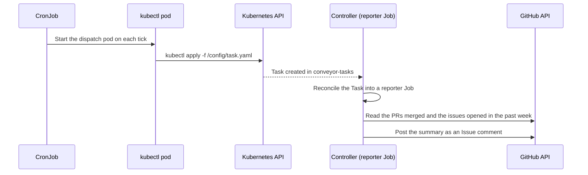

<!-- vale STE.Latin = NO -->
# Scheduled Reporter via CronJob
<!-- vale STE.Latin = YES -->

This example shows how to run a reporter Task on a recurring schedule
with a stock Kubernetes `CronJob`. Per
[ADR-0003](../../docs/adr/0003-triggers-out-of-process.md), triggers
are out-of-process. The CronJob runs `kubectl apply` to create a Task
on each tick.

## How it works

The CronJob (`weekly-report`, Monday 09:00 UTC) creates a Task on each
tick. The controller reconciles the
Task into a reporter Job. The agent summarizes the repo activity and
posts a comment on the GitHub Issue.



## Prerequisites

1. The `claude-code-reporter` ClusterAgentClass exists:
   ```sh
   kubectl apply -f ../../config/samples/conveyor_v1alpha1_clusteragentclass_reporter.yaml
   ```

2. The `conveyor-tasks` namespace exists:
   ```sh
   kubectl create namespace conveyor-tasks --dry-run=client -o yaml | kubectl apply -f -
   ```

3. The Secrets exist in the `conveyor-tasks` namespace:
   ```sh
   kubectl -n conveyor-tasks create secret generic anthropic-api-key \
     --from-literal=key="$ANTHROPIC_API_KEY"
   kubectl -n conveyor-tasks create secret generic github-token \
     --from-literal=token="$GITHUB_TOKEN"
   ```

## Setup

1. Edit `task-configmap.yaml`. Set `TARGET_REPO` and `REPORT_ISSUE_URL`
   under `spec.agent.config` to match your project. The controller
   projects them into the agent container as env vars.

2. Apply the resources:
   ```sh
   kubectl apply -f rbac.yaml
   kubectl apply -f task-configmap.yaml
   kubectl apply -f cronjob.yaml
   ```

3. Test with a manual run:
   ```sh
   kubectl -n conveyor-tasks create job --from=cronjob/weekly-report test-report
   ```

4. Watch for the created Task and the posted report:
   ```sh
   kubectl -n conveyor-tasks get tasks -w
   ```

## Customization

- **Schedule:** Edit `spec.schedule` in `cronjob.yaml`. It uses the
  standard cron syntax (for example, `0 9 * * *` for daily at 09:00 UTC).
- **Prompt:** Edit the `task.yaml` content in `task-configmap.yaml`.
- **Output:** Set `REPORT_ISSUE_URL` in the prompt to a GitHub Issue
  URL. The reporter posts the summary as a comment. Omit it to print
  to stdout only (read it with `kubectl logs`).
- **Resources:** Adjust `cpu`, `memory`, and `timeout` in the Task
  template to fit your repo size.

## RBAC

The CronJob runs with a dedicated ServiceAccount (`cronjob-reporter`).
The ServiceAccount has a single permission: `create` Tasks in
`conveyor-tasks`. It cannot read, list, or delete Tasks, and it has no
access to other resources.
