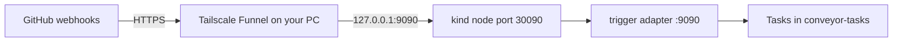

# Phone-workflow stack

One command installs everything that the GitHub flow of
[`docs/phone-workflow.md`](../../docs/phone-workflow.md) needs on a kind
cluster:

- the released controller, with the webhook trigger adapter on port 9090,
- the three reference agent classes (implementer, reviewer, reporter),
- the three GitHub trigger classes with dedupe: issues → implementer,
  PR review → reviewer, PR iterate → implementer,
- the `conveyor-tasks` namespace and the three Secrets,
- a NodePort Service, so that Tailscale Funnel on your PC can forward
  GitHub webhooks to the adapter.

This page is the install reference. The tutorial in
`docs/phone-workflow.md` shows how to use the flow from the GitHub
mobile app.



## Layout

```
phone-workflow-stack/
├── Makefile              kind-up | check | install | uninstall | test
├── kind-config.yaml      node port 30090 → 127.0.0.1:9090 on the host
├── secrets/              the three Secret files (git ignores them) + kustomization
├── base/                 install.yaml of VERSION, the manager patch, agent and trigger classes
├── overlays/kind/        the NodePort Service conveyor-trigger
└── scripts/              check-secrets, create-labels, init-repo, register-webhooks
```

The trigger classes come from the examples
[`github-issues-claude-code/`](../github-issues-claude-code/),
[`github-pr-claude-code/`](../github-pr-claude-code/) and
[`github-pr-iterate/`](../github-pr-iterate/), without a copy.

## Make targets and variables

| Target | What it does |
|---|---|
| `make kind-up` | Creates the kind cluster with the port mapping of `kind-config.yaml`. Does nothing when the cluster exists. |
| `make check` | Checks the Secret files and builds the kustomization. Needs no cluster, but it downloads `install.yaml`. |
| `make install` | `make check`, then applies the CRDs, waits for them, applies the stack, and waits for the manager. |
| `make uninstall` | Deletes the stack. Keeps the Secrets and their namespaces, the Funnel and the kind cluster. |
| `make test` | Runs shellcheck and the tests of the scripts. |

| Variable | Default | Meaning |
|---|---|---|
| `KUBE_CONTEXT` | `kind-conveyor-dev` | The kube context for `install` and `uninstall`. |
| `VERSION` | `v0.4.0` | The release of `install.yaml` and of the agent images. `latest` follows the newest release. The stack needs v0.4.0 or later: older CRDs have no `dedupe` field. |
| `KIND_CLUSTER` | `conveyor-dev` | The name of the kind cluster. |
| `INSTALL_YAML` | the release URL of `VERSION` | A URL or a local file, for example `../../dist/install.yaml` from `make build-installer`. |
| `AGENT_IMAGE_PREFIX`, `AGENT_TAG` | `ghcr.io/openconveyor`, `VERSION` | The agent images, for a local build that you load into kind. |

## Install

Do the steps in this order. Steps 1 to 3 are one-time steps.

### 1. Create the Secret files

The stack reads one file for each Secret from `secrets/`. Each file has
mode `600` and no trailing newline. See
[`secrets/README.md`](secrets/README.md).

1. Create a **fine-grained personal access token** for the target
   repository only, with these permissions:
   - Metadata: read
   - Contents: read and write
   - Issues: read and write
   - Pull requests: read and write

   The implementer pushes branches and opens PRs. The reviewer posts
   reviews. Both comment and set labels. Add Workflows: write only when
   the agent must change `.github/workflows/`.
2. Write the three files:

   ```sh
   cd examples/phone-workflow-stack
   umask 077
   printf '%s' 'github_pat_…'   > secrets/github-token
   printf '%s' 'sk-ant-…'       > secrets/anthropic-api-key
   printf '%s' "$(openssl rand -hex 32)" > secrets/github-webhook-secret
   scripts/check-secrets.sh
   ```

> [!WARNING]
> Do not write the webhook secret with `openssl rand -hex 32 > file`.
> The file then ends with a newline that GitHub does not sign, and every
> delivery fails with `401 signature verification failed`.

### 2. Prepare Tailscale Funnel

Funnel gives your PC a public HTTPS URL, for example
`https://<machine>.<tailnet>.ts.net/`. GitHub sends the webhooks there.

1. Use a Tailscale plan that includes Funnel. The Starter plan does not.
2. Turn on MagicDNS and HTTPS certificates for the tailnet.
3. Let your user change the serve config without sudo:

   ```sh
   sudo tailscale set --operator=$USER
   ```

   Without it, `tailscale funnel` answers `serve config denied`.
4. The first `tailscale funnel` run in step 5 prints an approval link.
   A tailnet owner must open it and approve Funnel for the machine.

### 3. Prepare the target repository

```sh
REPO=owner/name                       # for example scholtenmartijn/openconveyor-test
scripts/create-labels.sh "$REPO"      # conveyor:ready, conveyor:review, conveyor:iterate
scripts/init-repo.sh "$REPO"          # a first commit, when the repository is empty
```

The implementer can also start from an empty repository. A repository
with a default branch is easier to inspect.

### 4. Create the cluster and install the stack

```sh
make kind-up
make install
```

To use an existing cluster, skip `make kind-up` and set
`KUBE_CONTEXT`. The cluster then needs its own way to receive the
webhooks; the NodePort and the Funnel steps assume kind on your PC.

To install a local build before a release:

```sh
# From the repository root: the controller and the implementer image.
make docker-build IMG=controller:dev
make build-installer IMG=controller:dev
docker build -t localhost/agent-claude-implementer:dev \
  -f agents/claude-code-implementer/Dockerfile agents/
kind load docker-image controller:dev localhost/agent-claude-implementer:dev --name conveyor-dev
git checkout config/manager/kustomization.yaml   # build-installer edits it

cd examples/phone-workflow-stack
make install VERSION=dev INSTALL_YAML=../../dist/install.yaml \
  AGENT_IMAGE_PREFIX=localhost AGENT_TAG=dev
```

Build and load the reviewer and the reporter images the same way.

### 5. Start the Funnel

```sh
tailscale funnel --bg --https=443 http://127.0.0.1:9090
tailscale funnel status
curl -s https://<machine>.<tailnet>.ts.net/healthz   # ok
```

`--bg` stores the config in `tailscaled`, so the Funnel comes back
after a reboot. Mount the adapter at `/`. Do not use `--set-path`:
Funnel removes the path prefix before it forwards the request.

### 6. Register the webhooks

```sh
scripts/register-webhooks.sh "$REPO" https://<machine>.<tailnet>.ts.net
```

The script adds or updates three webhooks, one for each path. GitHub
sends each webhook to one URL, and the adapter serves one
`ClusterTriggerClass` for each path.

| Events | Path | ClusterTriggerClass |
|---|---|---|
| Issues | `/github/issues` | `github-issues-implementer` |
| Pull requests | `/github/pull-request` | `github-pr-reviewer` |
| Pull requests | `/github/pull-request-iterate` | `github-pr-iterate` |

GitHub sends a `ping` to each new webhook.

> [!NOTE]
> The first deliveries after the Funnel starts can fail with `EOF` on
> the GitHub side. Wait a minute and send the ping again (webhook →
> Recent Deliveries → Redeliver). Expect this once after every Funnel
> start.

## Verify

```sh
kubectl --context kind-conveyor-dev -n conveyor-system logs deploy/conveyor-controller-manager | grep 'Enabled trigger adapter'
curl -s -o /dev/null -w '%{http_code}\n' http://127.0.0.1:9090/healthz              # 200
curl -s -o /dev/null -w '%{http_code}\n' -X POST -d '{}' http://127.0.0.1:9090/github/issues   # 401
gh api repos/$REPO/hooks --jq '.[] | "\(.id) \(.config.url) \(.last_response.code)"'
```

Each `ping` gets `202 {"filtered":true}`: the signature is valid, and
the filters drop the event. The adapter does not log a rejected
signature at the default log level. Look at the recent deliveries of the
webhook on GitHub instead. To start the flow, label an issue
`conveyor:ready` (see the tutorial).

## Tear down

```sh
make uninstall                          # keeps the Secrets, the Funnel and the cluster
tailscale funnel --https=443 off        # stops the Funnel
kind delete cluster --name conveyor-dev # deletes the cluster and the Secrets in it
```

Delete the webhooks in the repository settings when you do not need
them again.
